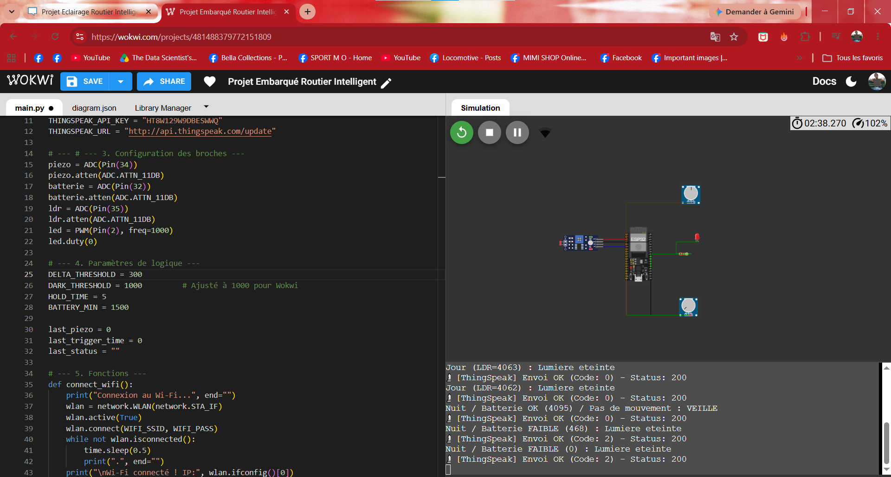
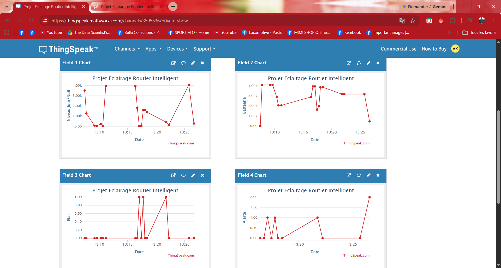

# 💡 Projet Embarqué : Éclairage Routier Intelligent Auto-Alimenté

## 📌 Description
Ce projet consiste en la conception et la simulation d'un système d'éclairage public intelligent et autonome. Il utilise la récupération d'énergie piézoélectrique et triboélectrique (simulée) pour alimenter un microcontrôleur ESP32. Le système gère l'éclairage de manière optimale et communique avec le Cloud pour la maintenance prédictive.

## 🛠️ Technologies utilisées
*   **Microcontrôleur** : ESP32
*   **Langage** : MicroPython
*   **Simulation** : Wokwi (Wokwi.com)
*   **Cloud IoT** : ThingSpeak (API HTTP)
*   **Concepts** : Gestion d'énergie, PWM, ADC, IoT.

## ⚙️ Fonctionnalités principales
1.  **Détection Jour/Nuit** : Utilisation d'une photorésistance (LDR) pour n'allumer le lampadaire que la nuit.
2.  **Détection de passage** : Utilisation d'un capteur piézoélectrique (simulé par un potentiomètre) pour allumer la lumière à 100% lors du passage d'un véhicule, avec un minuteur de 5 secondes.
3.  **Protection de la batterie** : Le système s'éteint et envoie une alerte critique si le niveau d'énergie du supercondensateur est trop bas.
4.  **IoT & Maintenance Prédictive** : Envoi de données (Luminosité, Batterie, État LED, Alertes) vers le Cloud (ThingSpeak).

---

## 📸 Aperçu du projet

### 1. Schéma de câblage (Simulation Wokwi)
Voici le montage électronique simulé sur Wokwi avec l'ESP32, les potentiomètres (piézo et batterie) et la photorésistance.

### 2. Tableau de bord Cloud (ThingSpeak)
Ce graphique montre l'évolution en temps réel des données envoyées par l'ESP32. On y voit clairement les pics d'activité (Field 3) et l'alerte critique de batterie vide (Field 4).

---

## 🚀 Comment lancer la simulation
1. Allez sur [Wokwi](https://wokwi.com/).
2. Créez un nouveau projet ESP32 / MicroPython.
3. Copiez le contenu de `diagram.json` dans l'onglet correspondant.
4. Copiez le contenu de `main.py` dans l'éditeur de code.
5. Modifiez la ligne `THINGSPEAK_API_KEY` avec votre propre clé.
6. Lancez la simulation !

## 👨‍💻 Auteur
[Amir Kallel]
LinkedIn : https://www.linkedin.com/in/amir-kallel-176b09291/
GitHub : https://github.com/Amir1798